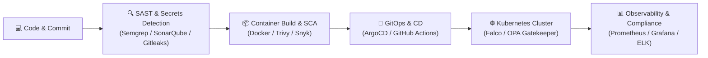

<div align="center">

  

  <a href="https://git.io/typing-svg">
    
  </a>

  <br/><br/>

  [](https://github.com/rajatyadav9984)
  [](https://linkedin.com/in/)
  [](mailto:your-email@example.com)
  [](https://github.com/rajatyadav9984)

</div>

---

### 🛡️ About Me

```yaml
professional:
  name: "Rajat Yadav"
  passion: "Securing modern cloud-native architectures & resilient CI/CD pipelines"
  philosophy: "Shift-Left Security: Detect early, remediate fast, automate everything."
  core_stack: ["Linux", "Kubernetes", "Docker", "Terraform", "GitHub Actions", "Trivy", "SonarQube"]
  current_focus: "Architecting zero-trust Kubernetes pipelines & automated compliance engines"
```

- 🔭 **Current Focus:** Engineering end-to-end **DevSecOps Pipelines**, hardening container runtimes, and building Infrastructure as Code (IaC).
- 🔐 **Security Mindset:** Integrating SAST, DAST, SCA, Container Scanning, Secrets Scanning, and Policy-as-Code natively into CI/CD.
- ⚡ **Cloud & Automation:** Hands-on with multi-cloud deployments, GitOps (ArgoCD), and self-healing infrastructure.
- 💬 **Ask me about:** `Docker`, `Kubernetes`, `Terraform`, `CI/CD Automation`, `Vulnerability Assessment`, `Linux Administration`, `Vault`.
- 🎯 **Goals:** Contributing to open-source cloud security projects and pioneering resilient zero-trust environments.

---

### 🔄 The DevSecOps Pipeline Ecosystem

<div align="center">
  
</div>



---

### 🛠️ Tech Stack & Tooling

<div align="center">

#### ☁️ Cloud & Infrastructure as Code (IaC)


#### 🐳 Containers & Orchestration


#### 🔒 Security, Compliance & DevSecOps Tools


#### 🚀 CI/CD & Automation


#### 📈 Monitoring, Logging & Observability


#### 💻 Systems & Scripting


</div>

---

### 📊 GitHub Activity & Metrics

<div align="center">

  
  

  <br/><br/>

  

</div>

---

### 🌟 DevSecOps Quote of the Day

> *"Security is not a blocker, it's the guardrail that lets you drive faster with confidence."*

---

<div align="center">
  <sub>Crafted with passion & security by <a href="https://github.com/rajatyadav9984">Rajat Yadav</a></sub>
</div>
