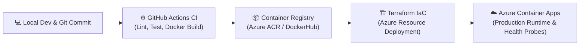

<div align="center">

  

  <a href="https://git.io/typing-svg">
    
  </a>

  <br/><br/>

  [](mailto:rajatyadav998424@gmail.com)
  [](https://www.linkedin.com/in/rjt-yadav/)
  [](https://github.com/rajatyadav9984)
  [](https://github.com/rajatyadav9984)

</div>

---

### 👨‍💻 About Me

```yaml
engineer:
  name: "Rajat Yadav"
  role: "Junior DevOps Engineer"
  primary_cloud: "Microsoft Azure"
  iac_preference: "Terraform (HCL)"
  philosophy: "Automate early, build resilient architectures, and fail forward."
  learning_focus: "Kubernetes (K8s) Cluster Architecture & Container Orchestration"
```

I am a proactive and detail-oriented **Junior DevOps Engineer** specializing in **Microsoft Azure**, **Terraform (IaC)**, **Linux environments**, and **CI/CD pipeline automation**.

I bridge the gap between development and cloud operations by creating repeatable, zero-touch deployment pipelines and building stable cloud infrastructure from code. Rather than just understanding concepts theoretically, I implement real-world cloud architectures with hands-on projects, automated test/deploy workflows, and containerized microservices.

- 🔭 **Current Focus:** Engineering modular Terraform infrastructure on Azure and multi-stage CI/CD pipelines with GitHub Actions.
- 🌱 **Learning Stage:** Deep-diving into **Kubernetes (K8s)** pods, services, ingress controllers, and cluster observability.
- 🐧 **Core Strengths:** Linux administration, Bash scripting, Git workflows, and modular Infrastructure as Code.
- 🎯 **Career Goal:** Delivering value as a high-performing Junior DevOps Engineer in progressive, cloud-first organizations.

---

### 🚀 Flagship Real-World Projects

<table>
  <tr>
    <td width="50%" valign="top">
      <h3 align="center">🩺 <a href="https://github.com/rajatyadav9984/DermaAgent-DevOps">DermaAgent-DevOps</a></h3>
      <p align="center">
        <a href="https://github.com/rajatyadav9984/DermaAgent-DevOps"></a>
        <a href="https://github.com/rajatyadav9984/DermaAgent-DevOps"></a>
        <a href="https://github.com/rajatyadav9984/DermaAgent-DevOps"></a>
      </p>
      <p><strong>Cloud-Native AI Skin Screening Architecture:</strong></p>
      <ul>
        <li>Automated provisioning of <strong>Azure Container Apps</strong>, Container Registry (ACR), and Networking using Terraform.</li>
        <li>Zero-downtime continuous deployment driven by <strong>GitHub Actions</strong> pipelines.</li>
        <li>Health probe endpoints, automated TLS/SSL configuration, and container environment management.</li>
      </ul>
      <p align="center">
        🔗 <a href="https://github.com/rajatyadav9984/DermaAgent-DevOps"><strong>Explore DermaAgent DevOps Repo →</strong></a>
      </p>
    </td>
    <td width="50%" valign="top">
      <h3 align="center">🏥 <a href="https://github.com/rajatyadav9984/healthpulse-devops-platform">HealthPulse DevOps Platform</a></h3>
      <p align="center">
        <a href="https://github.com/rajatyadav9984/healthpulse-devops-platform"></a>
        <a href="https://github.com/rajatyadav9984/healthpulse-devops-platform"></a>
        <a href="https://github.com/rajatyadav9984/healthpulse-devops-platform"></a>
      </p>
      <p><strong>Production-Grade Healthcare Operations Platform:</strong></p>
      <ul>
        <li>Enterprise-pattern deployment showcasing automated build, scan, and release workflows.</li>
        <li>Features a unified <strong>Digital Hospital Command Center</strong> dashboard.</li>
        <li>Designed with containerized services, monitoring hooks, and resilient operational pipelines.</li>
      </ul>
      <p align="center">
        🔗 <a href="https://github.com/rajatyadav9984/healthpulse-devops-platform"><strong>Explore HealthPulse Repo →</strong></a>
      </p>
    </td>
  </tr>
</table>

---

### 🔄 DevOps Workflow Architecture



---

### 🛠️ Skills & Technologies

<div align="center">

#### ☁️ Cloud & Infrastructure as Code (IaC)


#### 🐧 Operating Systems & Scripting


#### 🚀 CI/CD & Version Control


#### 🐳 Containerization & Orchestration

-326CE5?style=for-the-badge&logo=kubernetes&logoColor=white)

</div>

---

### 📂 Hands-On Terraform & Cloud Labs

| Repository | Focus Area | Description |
| :--- | :--- | :--- |
| 🌐 [**azure-terraform-infrastructure**](https://github.com/rajatyadav9984/azure-terraform-infrastructure) | Azure & Terraform | Modular HCL code for provisioning core virtual networks, subnets, and compute resources. |
| 🧪 [**terraform-azure-labs**](https://github.com/rajatyadav9984/terraform-azure-labs) | Hands-On Labs | Step-by-step practical implementation labs exploring Azure cloud infrastructure. |
| 🔗 [**Terraform-Implicit-Explicit-Dependency**](https://github.com/rajatyadav9984/Terraform-Implicit-Explicit-Dependency) | Terraform Concepts | In-depth demonstration of `depends_on` and graph execution in Terraform deployments. |
| 📦 [**terraform-azure-resource-group**](https://github.com/rajatyadav9984/terraform-azure-resource-group) | Azure Governance | Automated governance patterns for resource groups with lifecycle and tagging policies. |

---

### 📊 GitHub Activity & Statistics

<div align="center">

  
  

  <br/><br/>

  

</div>

---

<div align="center">
  <sub>Designed with ❤️ and dedication by <a href="https://github.com/rajatyadav9984">Rajat Yadav</a></sub>
</div>
